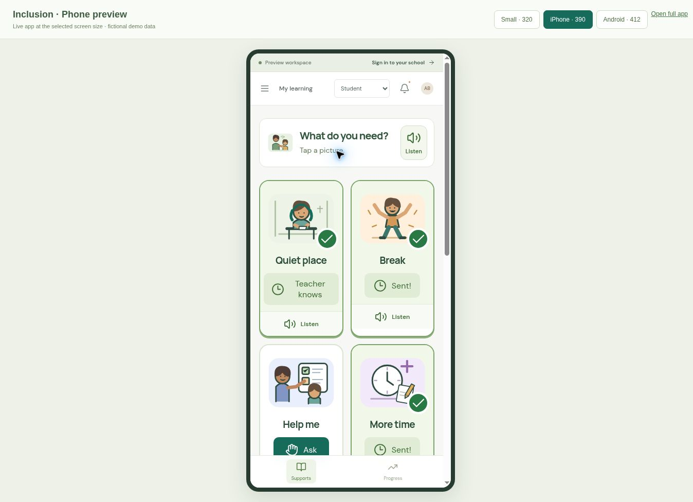

# Modernization review — November 11, 2026

- Production build passed on Node 24 with Vite 8.3.8.
- All 19 automated checks passed.
- Verified teacher acknowledgment and the matching student request status in the browser demo.
- Verified a student can request support by selecting a large picture and receive a visual sent confirmation. All support illustrations loaded.
- Verified student progress entry changes the graph from 76% to 79% and retains the reflection in the classroom view.
- Verified frequency logging increments once, undo restores the count, and a stopped duration is saved in today's total.
- Verified a generated guided draft remains editable and the team-approval action is disabled until review is explicitly confirmed.
- Checked responsive navigation and picture cards at desktop, small-phone (320), iPhone-sized (390), and Android-sized (412) browser widths. These are Chromium layout checks, not physical-device or WebKit certification.
- The demo uses fictional students. Live MongoDB persistence, external AI responses, Web Push delivery, managed extension installation, and production deployment have not been tested against configured school services.

For the live device frame locally, open `/device-preview.html` after starting the demo.
